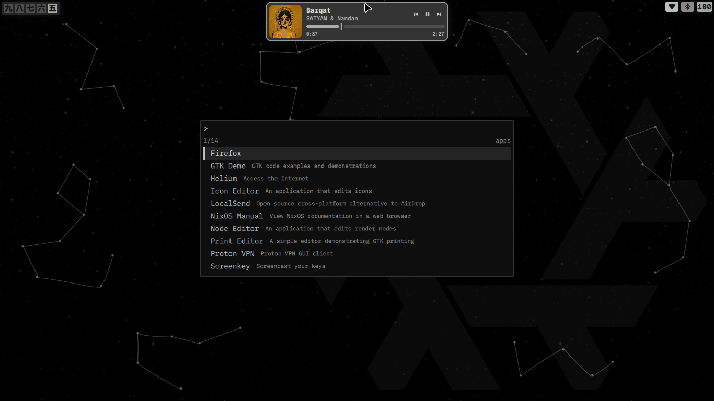
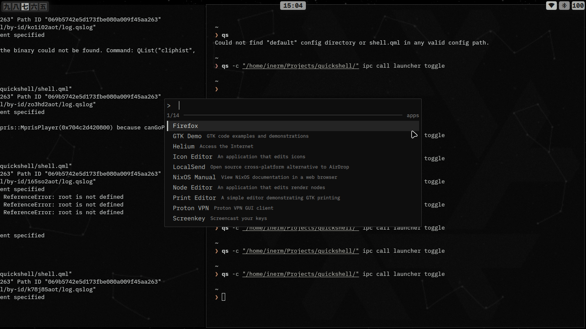
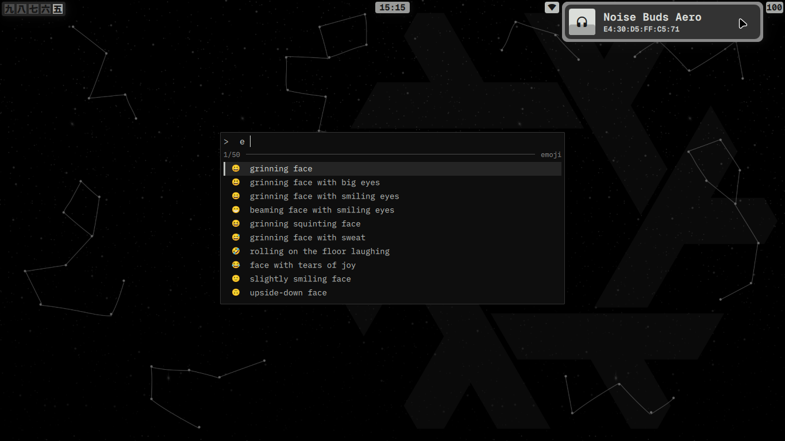
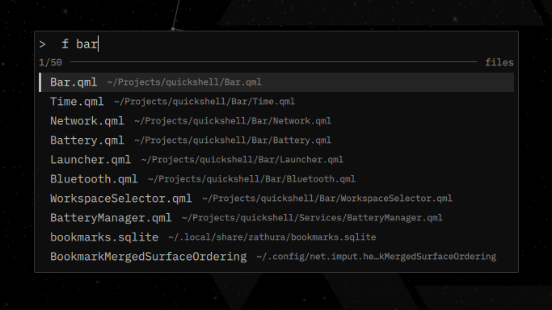
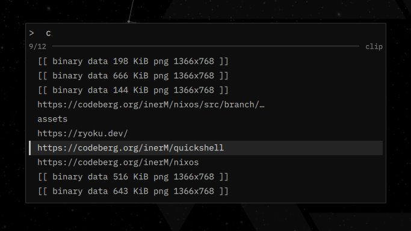

<div align="center">


# inert M / quickshell

**Quiet, Quick, Cute, and Clean**


Most Quickshell rices felt over-animated, mid, bloat shit to me. This one stays out of the way:
a thin bar that grows only when you touch it [Forked](https://git.voidarc.co.uk/quickshell), and one launcher(custom made) that does everything else.



</div>

---

## Looks

<table>
  <tr>
    <td width="50%"></td>
    <td width="50%"></td>
  </tr>
  <tr align="center">
    <td><sub>Apps</sub></td>
    <td><sub>Emoji + Bluetooth panel</sub></td>
  </tr>
  <tr>
    <td width="50%"></td>
    <td width="50%"></td>
  </tr>
  <tr align="center">
    <td><sub>Files</sub></td>
    <td><sub>Clipboard</sub></td>
  </tr>
</table>

---

## Features

- **Launcher** for apps, files, emoji and clipboard history, plus web search and system actions
- **Bar** with workspaces, clock, network, bluetooth and battery, each expanding into a small panel
- **Media toast** with seek bar and controls, shown when you hover the clock while something plays
- **Notifications** built in (it is the notification daemon, no extra service)
- Monochrome "Greek Noir inspired" palette
  
---

[!Note]
>this shell will only work with niri, if u want hyprland then refer [author](https://git.voidarc.co.uk/quickshell), else i dont know :)


## Launcher

Open it with an IPC call (bind these in your compositor, see [Run](#run)).
Type to filter, <kbd>Enter</kbd> to run, <kbd>Esc</kbd> to close.

| Prefix | Mode | What it does |
| :--- | :--- | :--- |
| *(none)* | **apps** | Desktop entries and system actions |
| `f ` | **files** | Search `$HOME` with `fd` + `fzf`. Text files open in your editor, everything else with `xdg-open` |
| `e ` | **emoji** | Search emoji by name and type it into the focused window |
| `c ` | **clip** | Clipboard history from `cliphist`, pasted into the focused window |

**Keys:** <kbd>↑</kbd> <kbd>↓</kbd> or <kbd>Ctrl</kbd> + <kbd>J</kbd> <kbd>K</kbd> / <kbd>N</kbd> <kbd>P</kbd> to move, click to run.

### Web search

Type a shortcut, a space, then your query, in the apps mode.

| Shortcut | Searches |
| :--- | :--- |
| `yt` | YouTube |
| `g` | Google |
| `gh` | GitHub |
| `ff` | Firefox's default engine |

### System actions

Type part of a name (or a keyword like `sleep` or `restart`) in the apps mode.

| Action | Does |
| :--- | :--- |
| logout, suspend, hibernate(dead for now), reboot, shutdown | Session and power |
| volume up / down, mute | `wpctl`, 5% steps, stays open so you can repeat |
| brightness up / down | `brightnessctl`, 5% steps, stays open |
| bluetooth on / off | `bluetoothctl power`, stays open |
| night mode up / down / toggle / off | `nightmode` helper, stays open |
| wifi, bluetooth | Opens `wifitui` or `bluetui` in kitty |

---

## Bar

| Widget | Shows | Click to expand |
| :--- | :--- | :--- |
| **Workspaces** (left) | Kanji numerals. Only the active, named and occupied workspaces appear. Focused, active and idle have three shades | Click a workspace to focus it |
| **Clock** (center) | `HH:mm`, only on the focused monitor | Hover while music plays for the media toast |
| **Network** (right) | Wi-Fi strength or wired icon, only when connected | Network name, IP address, saved or not |
| **Bluetooth** | Shown when a device is connected | Each device with its icon, name, MAC and battery (hover the icon for the percent) |
| **Battery** | Percentage, only on machines with a laptop battery | Battery name, energy in Wh, time remaining or until full, charge or discharge rate |

Panels collapse as soon as the pointer leaves. The bar window ignores input outside its widgets, so it never blocks the windows below.

**Notifications** appear in the clock slot for 5 seconds, with the summary and body.
**Media toast** shows cover art, title, artist, previous / pause / next, a draggable seek bar and elapsed and total time. Pausing while hovered keeps it open until you move away.

---

## Settings

There is no config file. Behaviour is changed with environment variables, IPC and a couple of files.

| Setting | Default | Purpose |
| :--- | :--- | :--- |
| `TERMINAL_BIN` | `kitty` | Terminal used to open text files from the launcher |
| `EDITOR_BIN` | `hx` | Editor used for text files |
| `EMOJI_FILE` | `~/.local/share/emoji-test.txt` | Emoji list. Falls back to the system `emoji-test.txt` |
| `Color.js` | Greek Noir | The whole palette, one place |
| `Bar/Launcher.qml` | | Web shortcuts (`web`) and system actions (`actions`) are plain lists at the top |

---

## Run

Quickshell reads a config from a folder. Either run it by path, or link it as your default:

```bash
git clone https://codeberg.org/inerM/quickshell ~/.config/quickshell
qs                      # default config
# or from anywhere
qs -p /path/to/quickshell
```

If you pass `-p`, pass the same flag on IPC calls so they reach that instance.

### IPC

```bash
qs ipc call launcher toggle      # open or close
qs ipc call launcher apps
qs ipc call launcher files
qs ipc call launcher emoji
qs ipc call launcher clipboard

qs ipc call root enableTabletMode
qs ipc call root disableTabletMode
```

### niri binds

```kdl
binds {
    Mod+Space       { spawn "qs" "ipc" "call" "launcher" "apps"; }
    Mod+Alt+Space   { spawn "qs" "ipc" "call" "launcher" "files"; }
    Mod+Shift+V     { spawn "qs" "ipc" "call" "launcher" "clipboard"; }
    Mod+Period      { spawn "qs" "ipc" "call" "launcher" "emoji"; }
}
```

Autostart with `spawn-at-startup "qs"`.

On NixOS, the [inerM/nixos](https://codeberg.org/inerM/nixos) flake builds and wraps all of this for you.

---

## Dependencies

| For | Needs |
| :--- | :--- |
| Core | [Quickshell](https://quickshell.org), [niri](https://github.com/YaLTeR/niri) |
| Bar | `upower`, `bluez`, NetworkManager, an MPRIS player |
| Launcher | `fd`, `fzf`, `file`, `xdg-utils` |
| Clipboard | `wl-clipboard`, `cliphist`, `wtype` |
| System actions | `wireplumber` (`wpctl`), `brightnessctl`, `kitty`, `wifitui`, `bluetui`, `nightmode` |
| Look | A monospace font and a [Nerd Font](https://www.nerdfonts.com) for the icons |

`nightmode` is a small helper script, you can find it in [inerM/nixos](https://codeberg.org/inerM/nixos/blob/main/OS/nighlight.nix). Skip the actions you don't use, the rest keeps working.

---

## Structure

```text
.
├── shell.qml          entry: one bar per screen, one launcher
├── Bar.qml            the panel window and its three rows
├── Color.js           palette
├── Bar/               Launcher, Time, WorkspaceSelector, Network, Bluetooth, Battery
├── Components/        Container (the expanding box), text helpers
└── Services/          singletons: niri, battery, bluetooth, network, mpris, notifications, IPC
```

Workspaces come from niri's event stream (`niri msg --json event-stream`), so nothing is polled.

---

## Thanks

[A Dumb Human](https://git.voidarc.co.uk/voidarc/quickshell) for the original shell this was forked from (Hyprland only), which I reworked for niri and extended with the launcher.

The logos are the official [Quickshell](https://quickshell.org) and [niri](https://github.com/YaLTeR/niri) marks, recolored to a single color.

---
## A note on AI

>I used AI for debugging, cleanup and code comments/readme. The config itself was written by hand. I'm not against it, but pasting straight from an LLM defeats the point of open community.

---

*This `README.md` was auto-generated by Claude, so mind twice before commiting instructions, ;) lol.*
